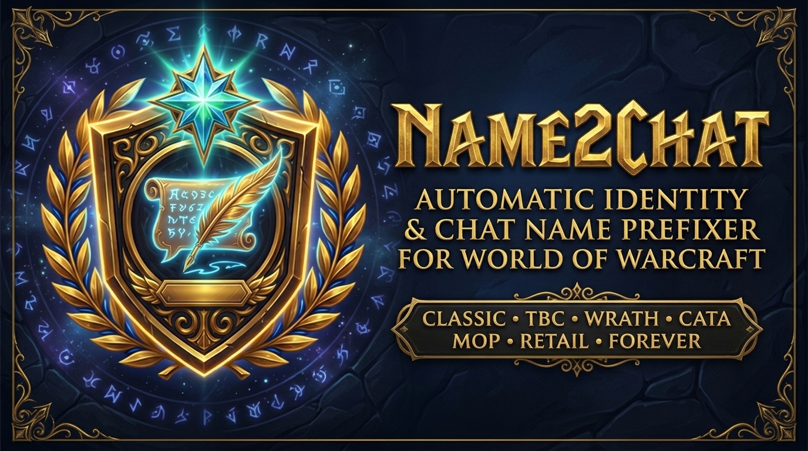

<div align="center">
  

  # Name2Chat

  **Automatically Prepends Your Main Name or Alias to Outgoing Guild, Party, Raid, Instance & Custom Channel Messages!**

  [](https://github.com/gOOvER/Name2Chat/actions/workflows/quality.yml)
  [](https://github.com/gOOvER/Name2Chat/actions/workflows/release.yml)
  [](https://github.com/gOOvER/Name2Chat/releases/latest)
  [](https://www.curseforge.com/wow/addons/name2chat)
  [](https://addons.wago.io/addons/Qb6mWqGP)
  [](https://www.wowinterface.com/downloads/info24357-Name2Chat.html)
  [](#-supported-wow-versions)
  [](LICENSE)
  [](https://donate.goover.dev)
</div>

---

**Name2Chat** is a maintained and modernized evolution of the classic *Incognito* addon for **all** current World of Warcraft versions. It automatically prepends your configured main name or nickname in front of your outgoing chat messages across Guild, Officer, Party, Raid, Instance, Communities (`J`), and custom channels.

**Example:**
```text
[Guild] [YourAlt]: Hello everyone!
```
becomes:
```text
[Guild] [YourAlt]: (YourMainName): Hello everyone!
```

---

## 🎮 Supported WoW Versions

- **Retail** (*Midnight `12.x`* & *The War Within `11.2.x`*)
- **Mists of Pandaria Classic** (`5.5.x`)
- **Cataclysm Classic** (`4.4.x`)
- **Wrath of the Lich King Classic** (`3.4.x` / `3.8.x`)
- **Burning Crusade Classic / Anniversary** (`2.5.x`)
- **World of Warcraft: Forever** (`16001`)
- **Classic Era / Hardcore / Season of Discovery** (`1.15.x`)

---

## ✨ Key Features & Options

- **Channel Selection**: Enable or disable name prefixing individually for:
  - **Guild & Officer** (`/g`, `/o`, and the **Guild & Communities `J`** window)
  - **Party** (`/p`)
  - **Raid** (`/raid`)
  - **Instance** (`/i` — LFR, Dungeons, Battlegrounds)
  - **Custom Channels** (supports comma-separated channel names)
- **Smart Matching**: Option to **hide your name if it already matches your current character's name**.
- **Command Ignore (`!`)**: Option to skip prefixing messages starting with `!` (for addon commands such as `!keys`).
- **Safe Combat Handling**: Option to add your name in combat when the client allows chat modifications (automatically skipped during Boss Encounters and Mythic+ to prevent taint/restrictions).
- **Guild Note Fallback for Other Players**: Optionally display the public guild note of guildmates who do not use Name2Chat locally in front of their incoming Guild/Officer messages.

---

## ⌨️ Slash Commands

Use `/name2chat` or `/n2c`, or open `ESC -> Options -> AddOns -> Name2Chat`:

| Command | Description |
| :--- | :--- |
| `/n2c config` | Open the configuration dialog |
| `/n2c enable` | Toggle adding your name to chat messages |
| `/n2c name <Name>` | Set the name displayed in your chat messages |

---

## 📦 Download & Links

- **GitHub Releases**: [github.com/gOOvER/Name2Chat/releases/latest](https://github.com/gOOvER/Name2Chat/releases/latest)
- **CurseForge**: [curseforge.com/wow/addons/name2chat](https://www.curseforge.com/wow/addons/name2chat)
- **Wago.io**: [addons.wago.io/addons/name2chat](https://addons.wago.io/addons/name2chat)
- **WoWInterface**: [wowinterface.com/downloads/info24357-Name2Chat.html](https://www.wowinterface.com/downloads/info24357-Name2Chat.html)
- **Issue Tracker**: [github.com/gOOvER/Name2Chat/issues](https://github.com/gOOvER/Name2Chat/issues)

---

## 📜 Credits & Support

- **Author**: **gOOvER** ([goover.dev](https://www.goover.dev))
- **License**: [GNU General Public License v3.0 (GPL-3.0)](LICENSE)
- **Support Development**: [donate.goover.dev](https://donate.goover.dev) • [Ko-fi](https://ko-fi.com/oldnoob) • [Buy Me a Coffee](https://www.buymeacoffee.com/goover)
